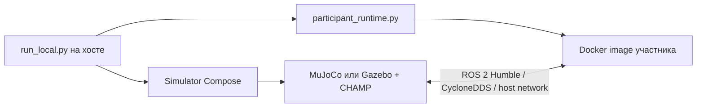

# Hackathon Go1 Simulator

Локальная среда разработки для Unitree Go1: MuJoCo Lowlevel (T2/T3),
Gazebo Classic + CHAMP Highlevel (T4), Course шириной 1 и 2 м (T5), Shell.
Включены модели Go1, source-built IMU plugin, пять RGB-D камер и ROS 2 API.
LOCAL предназначен для разработки и **не воспроизводит закрытое оценивание Judge**.
Официального Judge, scoring, скрытых сценариев и закрытого ground truth здесь нет.
Публичный `/odom/ground_truth` служит только для локальной диагностики.



## Требования

Linux x86_64; проверено на Ubuntu 22.04, Docker Engine 29.9.3 и Compose 5.7.0.
Нужны Python 3.10+, Bash, Git, Compose с поддержкой `!reset`, доступ к Docker
daemon и интернет для зависимостей.
ROS 2 Humble устанавливается внутри образов; на хосте ROS не обязателен.
Сборка требует места под ROS/Gazebo и Docker-слои; `BUILD_JOBS=1` снижает
пиковый расход RAM. Gazebo использует программный OpenGL без обязательной NVIDIA.
GUI требует X11 и `/dev/dri`; GPU/GUI отдельно от headless проверок не подтверждены.

**Согласованная база:**
`registry.cookcloud.ru/base_images/ros2-base-humble-amd64:v1.0.1`.
Организатор должен обеспечить участникам права на CookCloud registry.
Анонимный bearer-запрос manifest на 14.11.2026 вернул HTTP 200; это не гарантия
будущих прав и скачивания всех слоёв с машины участника. При необходимости
выполните `docker login registry.cookcloud.ru` локально; не передавайте токены в чат.
Не заменяйте базу другим образом без согласования.

## Подготовка и сборка

Все команды выполняются из корня этого репозитория:

```bash
docker pull registry.cookcloud.ru/base_images/ros2-base-humble-amd64:v1.0.1
bash scripts/prepare-standalone-cache.sh
SIM_IMAGE=go1-sim:public BUILD_JOBS=1 bash build_image.sh
```

Подготовка создаёт вспомогательные download-образы из CookCloud-базы,
получает закреплённые Git revisions и libchamp submodule, проверяет source hashes,
скачивает wheels по `config/standalone-python.lock` с SHA256.
Все Docker COPY inputs находятся в репозитории либо в подготовленном
`.dependency-cache/{sources,wheels}`. Кэш не входит в Git.

Повторная офлайн-проверка подготовленного кэша:

```bash
CACHE_OFFLINE=1 bash scripts/prepare-standalone-cache.sh
```

Можно импортировать доверенный bundle с теми же pins/hashes в пустой кэш:
`SOURCE_CACHE=/path/to/dependency-bundle bash scripts/prepare-standalone-cache.sh`.
Это опция; соседние checkout и внутренние репозитории не нужны.
Apt repositories не закреплены snapshot-датой; побайтово одинаковые образы
не обещаются. Проверка чистого сетевого скачивания всех зависимостей с нуля
отдельно от сборки пока NOT VERIFIED.

## Локальный запуск с образом участника

Участник передаёт **Docker image linux/amd64**, а не GitHub-репозиторий
определённой структуры. Сначала соберите или загрузите свой образ:

```bash
docker pull your-registry/your-solution:tag
python3 run_local.py --help
python3 run_local.py --task T2 --participant-image your-registry/your-solution:tag
python3 run_local.py --task T3 --participant-image your-registry/your-solution:tag
python3 run_local.py --task T4 --participant-image your-registry/your-solution:tag
python3 run_local.py --task T5 --course-width 1.0 --participant-image your-registry/your-solution:tag
python3 run_local.py --task T5 --course-width 2.0 --participant-image your-registry/your-solution:tag
```

По умолчанию: headless, Simulator `go1-sim:public`. Другой готовый Simulator:
`--sim-image IMAGE`. `--logs` показывает логи, `--timeout 90` задаёт readiness
в секундах, `--domain 151` выбирает ROS domain вместо автоматического.
Launcher ждёт `/clock` и состояние/готовность Simulator, затем запускает
ровно один Participant. При Ctrl+C/SIGTERM либо завершении контейнера очищает пару.
Возврат: 130 для SIGINT, 143 для SIGTERM, 1 при ошибке.

```bash
python3 run_local.py --task T4 --participant-image your-solution:tag --gui --logs
python3 run_local.py --task T5 --participant-image your-solution:tag --gpus all \
  --mount type=bind,src=/absolute/path/to/data,dst=/data,readonly
```

`--gpus` относится к Participant и требует настроенного GPU container runtime.
Bind mounts передаются явно; опцию можно повторять. LOCAL не добавляет CPU/RAM/PIDs
лимиты или `--user`; права процесса внутри образа определяет сам образ.
LOCAL использует host network и не является защищённой средой для чужих образов.
Simulator сохраняет собственный штатный entrypoint и пользователя `ros`.

## Контракт Participant

В образе обязателен исполняемый `/entrypoint.sh`. Launcher явно вызывает его
с одним аргументом `T2`, `T3`, `T4` или `T5`; ручной `/entrypoint.sh ping`
должен быстро вернуть успешный результат (пример возвращает JSON
`{"supported_tasks":["T2","T3","T4","T5"]}`). Задача работает в foreground,
обрабатывает SIGTERM и не запускает собственный Simulator.

Нужно загрузить ROS 2 Humble и типы сообщений, учитывать переданные
`ROS_DOMAIN_ID`, `RMW_IMPLEMENTATION`, `CYCLONEDDS_URI` и `GO1_DDS_LOCAL`.
Launcher предоставляет одинаковый loopback CycloneDDS config обеим сторонам.
Для расчётов по симуляционному времени используйте `/clock` и `use_sim_time`.
Собственные middleware/config не должны перезаписывать предоставленный DDS URI.

Минимальный функциональный пример интерфейса:

```bash
docker build --build-arg SIM_IMAGE=go1-sim:public \
  -t go1-participant:example participant_example
docker run --rm go1-participant:example ping
python3 run_local.py --task T4 --participant-image go1-participant:example
```

Пример подписывается на `/lowstate` в T2/T3, на `/imu/data` в T4/T5,
публикует нулевой `/cmd_vel` в T4/T5. Он **не содержит** походку, safety policy,
оценку одометрии, ArUco/Nav2 и не решает задания. В T2/T3 не посылает моменты.
Полный внутренний Participant с обученными моделями не распространяется.
Использовать этот пример или наследовать образ Simulator не обязательно.

## Публичный ROS 2 API

Направления указаны относительно Participant. Для lowstate/scan/IMU используйте совместимый QoS (`qos_profile_sensor_data`).
Camera publishers предлагают `RELIABLE`: для больших raw RGB/depth используйте
`RELIABLE` reader, чтобы получать повторную передачу потерянных UDP fragments.
`BEST_EFFORT` совместим, но на малых UDP-буферах может терять все большие кадры
в коротком окне. `/go1_ready` — transient local.

| Топик | Тип | Направление / режим |
|---|---|---|
| `/clock` | `rosgraph_msgs/msg/Clock` | вход, все сценарии |
| `/lowstate` | `unitree_go/msg/LowState` | вход, MuJoCo T2/T3 |
| `/lowcmd` | `unitree_go/msg/LowCmd` | выход, MuJoCo T2/T3 |
| `/cmd_vel` | `geometry_msgs/msg/Twist` | выход, Gazebo T4/T5 |
| `/body_pose` | `geometry_msgs/msg/Pose` | выход, Gazebo |
| `/joint_states` | `sensor_msgs/msg/JointState` | вход, Gazebo |
| `/imu/data` | `sensor_msgs/msg/Imu` | вход, Gazebo |
| `/scan` | `sensor_msgs/msg/LaserScan` | вход, Gazebo |
| `/foot_force` | `std_msgs/msg/Float32MultiArray` | вход, Gazebo |
| `/goal_pose` | `geometry_msgs/msg/PoseStamped` | вход, локальный Course auto_goal, один раз после появления подписчика |
| `/go1_ready` | `std_msgs/msg/Bool` | вход, Gazebo |
| `/tf`, `/tf_static` | `tf2_msgs/msg/TFMessage` | кинематика Simulator; odom TF — участник |
| `/odom` | `nav_msgs/msg/Odometry` | выход собственной оценки участника |
| `/odom/ground_truth` | `nav_msgs/msg/Odometry` | локальная диагностика; не официальный API оценивания |

Типы `unitree_go` берутся из закреплённого upstream Unitree ROS 2 (Go2 message
layout, 20 motor slots; модель Go1 использует 12 приводов).
Пять префиксов камер: `/camera`, `/camera_chin`, `/camera_left`,
`/camera_right`, `/camera_rearDown`. Под каждым — `/image_raw` и
`/depth/image_raw` (`sensor_msgs/msg/Image`), `/camera_info` и
`/depth/camera_info` (`sensor_msgs/msg/CameraInfo`), `/points`
(`sensor_msgs/msg/PointCloud2`), штатные image_transport
compressed/compressedDepth при наличии подписчиков. Точные remappings/frames
сохранены в `go1_description/urdf/sensors/rgbd_camera.xacro`.
T4 LOCAL включает front, T5 — все пять камер. Номинально front 640×480/15 sim-Hz,
остальные 464×400/10 sim-Hz; wall-time FPS зависит от RTF/нагрузки.

## Самостоятельный Simulator

```bash
docker compose -f docker-compose.yml -f docker-compose.headless.yml run --rm lowlevel
docker compose -f docker-compose.yml -f docker-compose.headless.yml run --rm highlevel
COURSE_WIDTH=2.0 docker compose -f docker-compose.yml -f docker-compose.headless.yml run --rm course
docker compose -f docker-compose.yml -f docker-compose.headless.yml run --rm shell
```

Без headless overlay Compose использует GUI/X11/DRI. Standalone lockstep по
умолчанию выключен; LOCAL T4/T5 явно включает его. Физика, конфигурации
контроллеров и параметры моделей сохранены. Из публичной копии удалены только
закрытые GT socket paths/serializers и соответствующий Gazebo-плагин.

## Проверки и ограничения релиза

Реальные результаты и команды: [PUBLIC_RELEASE_VERIFICATION](docs/PUBLIC_RELEASE_VERIFICATION.md).
После сборки обоих публичных образов короткие проверки запускаются так:

```bash
python3 -B tests/local_launch/runtime_check.py
python3 -B tests/local_launch/smoke.py /tmp/go1-public-smoke-new
python3 -B tests/local_launch/lifecycle.py /tmp/go1-public-lifecycle-new
python3 -B tests/local_launch/portable.py
python3 -B tests/check_public_tree.py
```

Каталоги результатов smoke/lifecycle должны быть новыми. Smoke по умолчанию
проверяет interface example; в T2/T3 probe публикует нулевой LowCmd для проверки
обратного DDS. Для совместимого полного Participant можно указать
`PARTICIPANT_IMAGE=IMAGE INTERFACE_ONLY=0`; этот режим дополнительно ожидает
`/odom` в T4/T5 и использует ROS setup примера либо `/opt/go1_participant/ros2_ws`.
Это тестовые probes транспорта, не реализация заданий.
Транспортные smoke-проверки не доказывают качество алгоритмов T2–T5.
Длительные campaigns, полноценная Nav2-навигация, GUI/GPU/LAN не проверены.
Известны отклонение движения CHAMP и снижение RTF при пяти камерах;
частота по sim-time не означает ту же частоту по wall-time.

Лицензии и notices: [licenses/README.md](licenses/README.md).
Оригинальный код проекта распространяется под MIT (корневой `LICENSE`);
сторонние компоненты — под своими лицензиями. Перед публикацией нужно
подтвердить способ доступа участников к CookCloud-базе.
