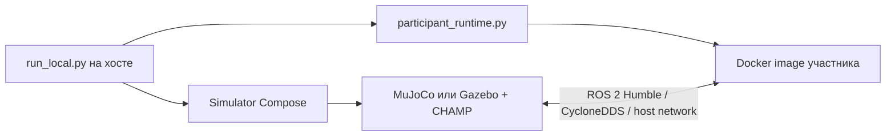

# Hackathon Go1 Simulator

**[Подробная инструкция запуска Simulator: три способа, T2–T5, Harbor и ROS 2](docs/SIMULATOR_LAUNCH_GUIDE_RU.md)**

Локальная среда разработки для Unitree Go1: MuJoCo Lowlevel (T2/T3),
Gazebo Classic + CHAMP Highlevel (T4), Course шириной 1 и 2 м (T5), Shell.
Включены модели Go1, source-built IMU plugin, пять RGB-D камер и ROS 2 API.
LOCAL предназначен для разработки и **не воспроизводит закрытое оценивание Judge**.
Официального Judge, scoring, скрытых сценариев и закрытого ground truth здесь нет.
Публичный `/odom/ground_truth` служит только для локальной диагностики.



# Go1 Simulator — руководство по развёртыванию и запуску

Для участников хакатона · Публичная симуляция Unitree Go1 · Ubuntu 22.04, amd64 · графический запуск

## Что даёт это руководство

С помощью этого руководства вы получите публичный Simulator из GitHub и Harbor, запустите роботизированную сцену для своего задания и при необходимости подключите собственный Docker-образ с программой управления. Для обычного запуска не нужны ROS 2 на хосте и сборка Simulator из исходников: ROS 2 Humble, MuJoCo и Gazebo находятся внутри готового образа.

Simulator моделирует робота, окружение и датчики и предоставляет ROS 2-интерфейсы. Он не оценивает решения, не выставляет баллы, не содержит судейскую систему и не предоставляет готовую навигацию участника. Запуск симуляции сам по себе не означает, что робот начнёт двигаться.

В этой инструкции стандартный способ работы — с графическим окном MuJoCo (T2/T3) или Gazebo Classic (T4/T5). Окно выводится на рабочий стол вашего Linux-компьютера по X11, а сама симуляция выполняется внутри Docker-контейнера.

Порядок работы: сначала один раз подготовьте окружение (раздел 1), затем выберите один из трёх независимых вариантов запуска (разделы 3–5). Проходить их последовательно не нужно. Команды отмечены, где они выполняются: на хосте или внутри контейнера.

## 1. Однократная подготовка окружения

### 1.1. Убедитесь, что компьютер подходит

Цель: проверить архитектуру и подготовить необходимые инструменты. Практически проверенная платформа — Ubuntu 22.04, x86_64/amd64. Нужны Git, Bash, Python 3.10+, Docker Engine и Docker Compose plugin с поддержкой !reset. Потребуется доступ к GitHub, Harbor и интернету для первоначальной установки. Для запуска с окном необходим действующий графический сеанс X11 (или XWayland с доступным X11-сокетом), установленный в системе графический драйвер и доступ к X-серверу; подключение только по SSH без доступного X-дисплея не подходит для описанного здесь способа. NVIDIA не обязателен, но производительность рендеринга зависит от оборудования и драйверов. Точные минимальные RAM/диск пока не нормированы; Gazebo с пятью камерами может потреблять заметные ресурсы.

Хост:

```bash
# Проверяем архитектуру процессора и ОС.
uname -m
dpkg --print-architecture
```

Ожидаем: соответственно x86_64 и amd64. Команда dpkg относится к Ubuntu/Debian.

Если Docker и остальные инструменты уже установлены, не устанавливайте их повторно — сразу переходите к проверке версий ниже. 

Если установлены конфликтующие старые пакеты Docker, сначала используйте официальную инструкцию Docker для Ubuntu и её раздел об удалении конфликтующих пакетов. Не удаляйте существующий Docker вслепую.

Для новой Ubuntu 22.04 установите Git и Docker из официального apt-репозитория:

```bash
# Базовые инструменты.
sudo apt update
sudo apt install -y ca-certificates curl git bash python3 x11-xserver-utils

# Ключ и репозиторий Docker для вашей версии Ubuntu.
sudo install -m 0755 -d /etc/apt/keyrings
sudo curl -fsSL https://download.docker.com/linux/ubuntu/gpg -o /etc/apt/keyrings/docker.asc
sudo chmod a+r /etc/apt/keyrings/docker.asc
sudo tee /etc/apt/sources.list.d/docker.sources <<EOF_DOCKER
Types: deb
URIs: https://download.docker.com/linux/ubuntu
Suites: $(. /etc/os-release && echo "${UBUNTU_CODENAME:-$VERSION_CODENAME}")
Components: stable
Architectures: $(dpkg --print-architecture)
Signed-By: /etc/apt/keyrings/docker.asc
EOF_DOCKER

# Docker Engine и Compose plugin.
sudo apt update
sudo apt install -y docker-ce docker-ce-cli containerd.io docker-buildx-plugin docker-compose-plugin
sudo systemctl enable --now docker
```

Для запуска без sudo при необходимости добавьте текущего пользователя в группу Docker:

```bash
sudo groupadd -f docker
sudo usermod -aG docker "$USER"
```

Ожидаем: после выхода из сеанса Ubuntu и повторного входа команды ниже выполняются без sudo. Членство в группе docker предоставляет практически root-доступ к хосту; используйте его только на доверенной машине.

Хост — проверка установки:

```bash
# Проверяем наличие инструментов и соединение с Docker Engine.
python3 --version
git --version
docker version
docker compose version
docker info
```

Ожидаем: Python версии не ниже 3.10; docker version показывает Client и Server, docker info выполняется без ошибки доступа. Если Docker недоступен, проверьте sudo systemctl status docker и id -nG.

Хост — подготовка X11 (один раз перед графическим запуском): Если команда xhost отсутствует, установите x11-xserver-utils через sudo apt install -y x11-xserver-utils.

```bash
# Проверяем, что терминал открыт в графическом сеансе и X11 доступен.
printf 'DISPLAY=%s\n' "${DISPLAY:-<не задан>}"
ls -ld /tmp/.X11-unix
xhost

# Разрешаем доступ локальным процессам с UID вашего пользователя.
xhost +si:localuser:"$(id -un)"
```

Ожидаем: DISPLAY содержит адрес вида :0 или :1, каталог /tmp/.X11-unix существует, а xhost подключается к X-серверу без ошибки. Если DISPLAY пуст, графический сеанс не настроен: войдите в рабочий стол Ubuntu или выберите запуск без окна. В сеансе Wayland для этого способа должен работать XWayland.

Штатный Compose проекта передаёт в контейнер DISPLAY, подключает X11-сокет /tmp/.X11-unix и устройство /dev/dri.Поэтому отдельно добавлять docker run -e DISPLAY ... -v ... к run_local.py не нужно. Если вход по X11 отклонён из-за различия UID контейнера и хоста, см. раздел с неполадками — не используйте sudo xhost. 

Безопасность: не используйте без необходимости широкое правило xhost +local:: оно разрешает подключение к дисплею всем локальным процессам. Точечное правило выше предпочтительнее; после работы его можно отменить командой xhost -si:localuser:"$(id -un)".

### 1.2. Скачайте исходники и скрипты запуска с GitHub

Цель: получить run_local.py, Compose-файлы, ROS-конфигурацию и документацию. Сам Docker-образ Simulator находится не в GitHub, а в Harbor.

Хост — первый раз:

```bash
# Получаем публичный репозиторий, затем переходим в его корень.
git clone https://github.com/Urika000/go1-simulator-public.git
cd go1-simulator-public
```

Ожидаем: создан каталог go1-simulator-public, внутри него находятся run_local.py, docker-compose.yml и docker-compose.headless.yml. Все следующие команды запуска выполняются из этого каталога.

Если проект уже скачан, вместо клонирования используйте только обновление из его корня (сначала сохраните свои локальные изменения):

```bash
# Обновляем существующую копию без автоматического merge.
git pull --ff-only origin main
```

### 1.3. Получите Docker-образ Simulator — выберите один путь

Для обычного использования рекомендуется путь A. Путь B нужен только тем, кто собирается изменять исходники Simulator. Выполнять оба пути не нужно.

Путь A. Готовый образ из Harbor (рекомендуется)

Хост, корень проекта:

```bash
# Авторизуемся учётной записью Harbor, выданной организаторами.
docker login registry.cookcloud.ru

# Запоминаем имя релиза и скачиваем готовый образ.
export SIM_IMAGE=registry.cookcloud.ru/go1-hackathon-remote-stage/go1-sim:v1.0
docker pull "$SIM_IMAGE"

# Проверяем платформу и фактически полученный digest.
docker image inspect "$SIM_IMAGE" --format '{{.Os}}/{{.Architecture}}'
docker image inspect "$SIM_IMAGE" --format '{{range .RepoDigests}}{{println .}}{{end}}'
```

Ожидаем: строку linux/amd64 и следующий digest релиза (он подтверждён для опубликованного образа v1.0):

registry.cookcloud.ru/go1-hackathon-remote-stage/go1-sim@sha256:c79ddbece6cc7d00f114a9a9a09be0bae061ebb35ca722bcbe51bf75fce1b2e3

Если digest отличается, уточните версию образа у организаторов; не считайте другой digest проверенным v1.0. Сборка из исходников после этого не требуется.

Путь B. Собрать Simulator самостоятельно (необязательно)

Хост, корень проекта:

```bash
# Получаем базовый образ и закреплённые исходные зависимости.
# Авторизация не обязательна, чтобы загружать образа из registry.
docker pull registry.cookcloud.ru/base_images/ros2-base-humble-amd64:v1.0.1
bash scripts/prepare-standalone-cache.sh

# Собираем собственный образ; BUILD_JOBS=1 уменьшает пиковую нагрузку на RAM.
SIM_IMAGE=go1-sim:public BUILD_JOBS=1 bash build_image.sh
export SIM_IMAGE=go1-sim:public
docker image inspect "$SIM_IMAGE" --format '{{.Os}}/{{.Architecture}} {{.Id}}'

# Чтобы выгружать образа (docker push) в registry - авторизуйтесь. 
docker login registry.cookcloud.ru
```
Логин и пароль организаторы пришлют по почте, вводите их интерактивно и не сохраняйте в исходниках проекта.

Ожидаем: локальный образ go1-sim:public платформы linux/amd64. Время сборки и загрузки зависимостей зависит от ресурсов и сети. Подробнее — README, раздел о подготовке и сборке. Самостоятельный образ не следует отождествлять с официальным digest из пути A.

### 1.4. Проверьте готовность и переходите к запуску

Хост, корень проекта:

```bash
# Убеждаемся, что образ виден Docker, Compose принимает конфигурацию,
# а Python-запускатель доступен.
docker image inspect "$SIM_IMAGE" --format '{{.Os}}/{{.Architecture}}'
SIM_IMAGE="$SIM_IMAGE" docker compose -f docker-compose.yml config --quiet
python3 run_local.py --help
```

Ожидаем: архитектура linux/amd64, отсутствие ошибок основной (графической) конфигурации Compose и справка с --task, --sim-only, --sim-image, --gui. Если всё так, подготовка закончена. Переменная SIM_IMAGE действует только в текущем терминале: в новом терминале повторите export SIM_IMAGE=... (повторно скачивать образ не нужно).

## 2. Выберите способ запуска — это альтернативы, а не этапы

| Способ                                                   | Что хотите сделать                                             | Что запускается                                        |
|----------------------------------------------------------|----------------------------------------------------------------|--------------------------------------------------------|
| **А. Автоматический запуск только Simulator** → раздел 3 | Посмотреть сцену, датчики, ROS 2 без кода команды              | Один контейнер Simulator; `run_local.py --sim-only`    |
| **Б. Ручной запуск из контейнера** → раздел 4            | Изучать и самостоятельно выбирать ROS 2 launch и его аргументы | Один интерактивный контейнер; `ros2 launch` вручную    |
| **В. Simulator вместе со своим решением** → раздел 5     | Запустить собственную программу управления рядом с симуляцией  | Два контейнера; `run_local.py --participant-image ...` |

Выберите один способ и выполняйте только его команды. Все основные команды ниже используют графический режим: MuJoCo или Gazebo должен открыть окно на вашем рабочем столе. Каждый способ показывает отдельные варианты T2, T3, T4 и T5. Не запускайте несколько Gazebo одновременно: при hosсамостоятельное обучение или дообучение RL-политикиt network они могут конфликтовать по портам Gazebo master. После каждого сценария остановите его, прежде чем начинать другой.

## Если вам нужен запуск симуляции с использованием карты NVIDEA или если mujoco симуляция фризит
Возможность использования встроеной графики добавлена по умолчанию.
Что бы симуляция Mujoco и Gazebo использовали дискретную карту для отрисовки графики [выполните эту иснтрукцию](https://github.com/Urika000/go1-simulator-public/blob/main/docs/go1-nvidia-instructions.md)

Так же для ускорения отрисовки mujoco можно отключить тени (shadow) и отражения (reflection) в настройках OpenGL Effects. Это делает mujoco комфортной без использования какой-либо gpu.


Если проблема с фризами симулятора для вас не решилась, напишите в чат организоторов - посмотрим решения под ваш случай. Возможно вам нужно обратить внимание на настройки OpenGL.

## 3. Способ А — запустить только Simulator одной командой

Зачем: быстро включить физику, сцену и датчики без программы управления и увидеть окно симулятора. Внешний run_local.py самостоятельно создаёт один контейнер, подключает его к X11 хоста через Compose, запускает нужный сценарий, подбирает ROS_DOMAIN_ID и ждёт готовности Simulator.

Хост, корень проекта. Выберите ОДНУ команду:

T2 — MuJoCo Lowlevel, управление суставами через /lowcmd:

```bash
# Только симуляция T2; без подключённого решения робот не получает команды управления.
python3 run_local.py --task T2 --sim-only \
  --sim-image "$SIM_IMAGE" --gui --logs
```

T3 — тот же MuJoCo Lowlevel, что и в T2:

```bash
# Физика и ROS-интерфейс те же; T3 отличается задачей участника, а не сценой.
python3 run_local.py --task T3 --sim-only \
  --sim-image "$SIM_IMAGE" --gui --logs
```

T4 — Gazebo Classic + CHAMP, передняя RGB-D камера:

```bash
# Высокоуровневое управление /cmd_vel; включён Gazebo lockstep.
python3 run_local.py --task T4 --sim-only \
  --sim-image "$SIM_IMAGE" --gui --logs
```

T5 — Course, проход шириной 1 м, пять RGB-D камер:

```bash
python3 run_local.py --task T5 --sim-only \
  --sim-image "$SIM_IMAGE" --course-width 1.0 --gui --logs
```

T5 — Course, проход шириной 2 м, пять RGB-D камер:

```bash
python3 run_local.py --task T5 --sim-only \
  --sim-image "$SIM_IMAGE" --course-width 2.0 --gui --logs
```

Ожидаем: на рабочем столе откроется окно MuJoCo для T2/T3 или Gazebo Classic для T4/T5. В терминале появятся логи загрузки и сообщение Simulator started. Для T2/T3 доступны /clock и /lowstate; для T4/T5 — /go1_ready, IMU, LiDAR и камеры. Окно показывает сцену, но без внешних команд робот не обязан двигаться. Данные ROS 2 можно проверить по разделу 7.

Как остановить: нажмите Ctrl+C в терминале с run_local.py. Запускатель должен остановить и удалить принадлежащий ему контейнер. Режимы T4/T5 уже включают нужный lockstep и набор камер; вручную задавать эти параметры в способе А не нужно.

## 4. Способ Б — открыть контейнер и самому запускать ROS 2 launch

Зачем: работать с ROS 2 напрямую — выбирать сценарий, менять параметры launch и наблюдать внутренние узлы, не пересобирая Docker-образ. Контейнер запускается без симуляции, но с подключённым X11 хоста; ros2 launch вы вызываете внутри него самостоятельно, после чего окно симулятора появляется на рабочем столе.

### Шаг 1. Откройте интерактивный контейнер

Хост, терминал 1:

```bash
# Запускаем контейнер с Bash через GUI Compose (он пробрасывает X11 и /dev/dri).
# ROS-домен 151 — пример; убедитесь, что его не использует другая симуляция.
SIM_IMAGE="$SIM_IMAGE" \
DISPLAY="$DISPLAY" \
ROS_DOMAIN_ID=151 \
GO1_DDS_LOCAL=1 \
GO1_SIM_CYCLONEDDS_URI=file:///home/ros/ros2_custom_config_setup/cyclonedds_local.xml \
docker compose -f docker-compose.yml \
  run --rm --no-deps --pull never --name go1-manual shell
```

Ожидаем: вместо терминала хоста появляется приглашение Bash внутри контейнера go1-manual. Симуляция ещё не запущена. Контейнер получает переменную DISPLAY, необходимую для вывода окна на хост. Убедитесь, что домен 151 и имя контейнера go1-manual не заняты другим запуском.

### Шаг 2. Подготовьте ROS 2 environment внутри контейнера

Внутри go1-manual:

```bash
# Если вы вносили измнения в пакеты, подключаем ROS 2, собранный workspace и пути моделей/плагинов Gazebo.
# По умолчанию эти команды уже выпонены в контейнересамостоятельное обучение или дообучение RL-политики
source /opt/ros/humble/setup.bash
source /home/ros/go1_ws/install/setup.bash
source /etc/go1_sim_env.sh

# Проверяем, что launch-пакет доступен, а DISPLAY передан в контейнер.
ros2 pkg prefix go1_simulation
printf 'DISPLAY=%s\n' "${DISPLAY:-<не задан>}"
ls -ld /tmp/.X11-unix
```

Ожидаем: команда ros2 pkg prefix возвращает путь установленного пакета без ошибки, DISPLAY не пуст, а сокет X11 доступен в контейнере.

### Шаг 3. Выберите и запустите ОДИН сценарий

Внутри go1-manual:

T2 или T3 — MuJoCo Lowlevel (одна и та же команда Simulator):

```bash
# Запускаем MuJoCo с графическим окном на хосте.
ros2 launch go1_simulation scenario.launch.py scenario:=lowlevel gui:=true
```

T4 — Gazebo Highlevel, CHAMP, передняя камера:

```bash
ros2 launch go1_simulation scenario.launch.py \
  scenario:=highlevel gui:=true cameras:=false lockstep:=true
```

T5, проход шириной 1 м:

```bash
ros2 launch go1_simulation scenario.launch.py \
  scenario:=course width:=1.0 gui:=true cameras:=true lockstep:=true
```

T5, проход шириной 2 м:

```bash
ros2 launch go1_simulation scenario.launch.py \
  scenario:=course width:=2.0 gui:=true cameras:=true lockstep:=true
```

Что происходит: scenario.launch.py запускает MuJoCo (T2/T3) или Gazebo Classic с CHAMP, контроллерами и датчиками (T4/T5). gui:=true включает графическое окно соответствующего симулятора; X11 проброшен в контейнер через основной Compose. cameras:=false в T4 оставляет переднюю RGB-D, cameras:=true в T5 включает остальные четыре; lockstep:=true задаёт режим синхронизации Gazebo. 

Ожидаем: на рабочем столе откроется окно MuJoCo для T2/T3 или Gazebo для T4/T5; в терминале появятся сообщения запуска ROS 2 и начнут публиковаться /clock и профильные топики. Если топики есть, но окна нет, проверьте X11 в разделе 9. Для проверки ROS 2 можно открыть второй терминал на хосте:

```bash
# Хост, терминал 2: подключаемся к УЖЕ работающему контейнеру.
docker exec -it go1-manual bash
```

Во втором shell повторите три source из шага 2 (в новой оболочке окружение нужно подключить заново), затем выполните ros2 topic list --no-daemon. Ожидайте /lowstate в T2/T3 или /imu/data, /scan, /camera/image_raw в T4/T5. Подробные диагностические команды — раздел 7.

### Шаг 4. Остановите симуляцию

В терминале с ros2 launch нажмите Ctrl+C. После возврата в Bash выполните exit во всех открытых оболочках контейнера. Благодаря --rm контейнер удалится; его отсутствие можно проверить на хосте командой docker ps -a --filter name=go1-manual. В некоторых окружениях Gazebo при прерывании может выводить ошибки дочерних процессов; если контейнер не остановился, используйте docker stop go1-manual на хосте.

## 5. Способ В — запустить Simulator вместе с Docker-образом своей команды

Зачем: отлаживать взаимодействие собственной программы с датчиками и актуаторами робота через публичный ROS 2 API и одновременно наблюдать робота в окне симулятора. Это запуск двух контейнеров для разработки, не автоматическая проверка или оценивание решения.

В Docker-образе команды должен быть исполняемый /entrypoint.sh, который принимает аргумент T2, T3, T4 или T5. Контракт ping и требования к содержимому образа задаются отдельным ТЗ хакатона; эта инструкция не заменяет их. Образу нужны совместимые ROS 2 Humble, типы сообщений и CycloneDDS; приложение должно использовать окружение, переданное запускателем, и не поднимать второй Simulator. Команда самостоятельно собирает этот образ; примерное решение из репозитория не требуется.

### Шаг 1. Укажите образ своей команды

Хост, корень проекта:

```bash
# Вводим готовый локальный тег или адрес собственного Docker-образа.
read -r -p 'Docker image вашей команды: ' PARTICIPANT_IMAGE

# Проверяем, что образ доступен в локальном Docker и имеет linux/amd64.
docker image inspect "$PARTICIPANT_IMAGE" --format '{{.Os}}/{{.Architecture}}'
```

Ожидаем: linux/amd64. Если образ находится только в registry и ещё не скачан, сначала выполните docker pull "$PARTICIPANT_IMAGE", затем повторите проверку. Образ участника здесь не создаётся и не оценивается.

### Шаг 2. Запустите ОДИН нужный режим

Хост, корень проекта:

T2:

```bash
python3 run_local.py --task T2 \
  --sim-image "$SIM_IMAGE" --participant-image "$PARTICIPANT_IMAGE" \
  --gui --logs
```

T3:

```bash
python3 run_local.py --task T3 \
  --sim-image "$SIM_IMAGE" --participant-image "$PARTICIPANT_IMAGE" \
  --gui --logs
```

T4:

```bash
python3 run_local.py --task T4 \
  --sim-image "$SIM_IMAGE" --participant-image "$PARTICIPANT_IMAGE" \
  --gui --logs
```

T5, проход 1 м:

```bash
python3 run_local.py --task T5 --course-width 1.0 \
  --sim-image "$SIM_IMAGE" --participant-image "$PARTICIPANT_IMAGE" \
  --gui --logs
```

T5, проход 2 м:

```bash
python3 run_local.py --task T5 --course-width 2.0 \
  --sim-image "$SIM_IMAGE" --participant-image "$PARTICIPANT_IMAGE" \
  --gui --logs
```

Что происходит: скрипт сначала создаёт Simulator через Compose, дожидается его готовности и затем запускает образ участника через Docker CLI. Оба контейнера получают один ROS_DOMAIN_ID и совместимые настройки CycloneDDS. Программа команды получает датчики Simulator и может отправлять команды управления в публичные ROS 2-топики.

Ожидаем: откроется окно MuJoCo (T2/T3) или Gazebo (T4/T5), а в терминале после Simulator started появится Pair started; работают два контейнера. Это подтверждает запуск, а не выполнение критериев задания. Управление роботом зависит от кода команды. Остановка — Ctrl+C в терминале с run_local.py; оба контейнера должны быть удалены.

Особенности T4/T5. Базовый TF-фрейм Simulator — trunk. Если ваше решение создаёт одометрию, согласуйте /odom и собственное преобразование odom → trunk с публичным ТЗ. В Course может публиковаться вспомогательная цель PoseStamped через /goal_pose; это не Nav2 Action /navigate_to_pose и не механизм оценивания. Если программа принимает только Action, этот вспомогательный топик не запустит её навигацию автоматически.

## 6. Как убедиться, что Simulator действительно работает

Проверка ROS 2 необязательна для каждого запуска. Она полезна, если сцена загрузилась, но вы хотите увидеть доступные датчики или выяснить, почему программа не получает сообщения.

Для способа А или В откройте второй терминал на хосте и скопируйте имя контейнера из строки Simulator=... в сообщении запускателя:

```bash
# Подключаемся к уже запущенному Simulator.
read -r -p 'Имя контейнера из Simulator=: ' SIM_CONTAINER # ВОзможны альтернативные команды для задания SIM_CONTAINER
docker exec -it "$SIM_CONTAINER" bash
```

Для ручного способа Б вы уже находитесь внутри go1-manual или можете открыть туда терминал через docker exec -it go1-manual bash.

Внутри контейнера Simulator:

```bash
# Подключаем ROS-окружение; печатаем узлы и топики.
source /opt/ros/humble/setup.bash
source /home/ros/go1_ws/install/setup.bash
source /etc/go1_sim_env.sh
ros2 node list --no-daemon
ros2 topic list --no-daemon
ros2 topic echo /clock --once --qos-reliability best_effort
```

Ожидаем: список работающих ROS-узлов и топиков, а /clock возвращает сообщение симуляционного времени. Если команда echo --once ждёт долго, проверьте состояние Simulator и при необходимости прервите её Ctrl+C.

Для MuJoCo T2/T3:

```bash
# Проверяем публикацию состояния робота.
ros2 topic echo /lowstate --once --qos-reliability best_effort
```

Ожидаем: сообщение unitree_go/msg/LowState с состоянием приводов. Без внешней программы команды /lowcmd могут отсутствовать.

Для Gazebo T4/T5:

```bash
# Проверяем готовность и получение данных датчиков.
ros2 topic echo /go1_ready --once --qos-durability transient_local --qos-reliability reliable
ros2 topic echo /imu/data --once --qos-reliability best_effort
ros2 topic info /camera/image_raw --verbose
ros2 topic echo /camera/image_raw --once --field header --qos-reliability reliable
```

Ожидаем: готовность /go1_ready=true, данные IMU и заголовок RGB-изображения передней камеры. В T5 дополнительно доступны /camera_chin/image_raw, /camera_left/image_raw, /camera_right/image_raw, /camera_rearDown/image_raw; в T4 эти дополнительные камеры выключены. Большие кадры лучше читать с RELIABLE QoS. При нехватке ресурсов кадры могут появляться медленнее, чем ожидается по sim-time.

Выход из диагностического Bash — exit. Не завершайте контейнер целиком, если основной Simulator ещё используется.

## 7. Краткий справочник параметров run_local.py

Полный актуальный список покажет python3 run_local.py --help (на хосте, из корня проекта).

| Аргумент                    | Для чего                                      | Значение по умолчанию / особенность                                                             |
|-----------------------------|-----------------------------------------------|-------------------------------------------------------------------------------------------------|
| `--task T2\\|T3\|T4\|T5`    | Выбрать режим                                 | Обязателен                                                                                      |
| `--sim-only`                | Создать только Simulator                      | Выключен; без Participant                                                                       |
| `--sim-image IMAGE`         | Образ Simulator                               | `$SIM_IMAGE`, иначе локальный `go1-sim:public`                                                  |
| `--participant-image IMAGE` | Подключить свой образ                         | Используйте явно в способе В; в `--sim-only` игнорируется                                       |
| `--gui` / `--headless`      | С окном / без окна MuJoCo или Gazebo          | CLI по умолчанию headless; в этом руководстве **явно используется** `--gui`. Флаги несовместимы |
| `--course-width 1.0\\|2.0`  | Ширина Course                                 | 1.0; только T5                                                                                  |
| `--domain N`                | Указать ROS_DOMAIN_ID вручную                 | Автоматически выбирается из 100–229; вручную 1–232                                              |
| `--timeout N`               | Сколько ждать готовности Simulator            | 90 секунд; **не** время выполнения задания                                                      |
| `--logs`                    | Показать непрерывные логи                     | Выключен                                                                                        |
| `--gpus all`                | Передать GPU в контейнер команды              | Только способ В, требует NVIDIA runtime                                                         |
| `--mount type=bind,...`     | Подключить каталог хоста к контейнеру команды | Только способ В, задаётся явно                                                                  |

При выборе --domain обе стороны получают один ROS domain. В автоматическом режиме параметры DDS задаёт запускатель — их не нужно подменять в приложении. В режиме без Participant аргументы --participant-image, --gpus и --mount не влияют на запуск.

## 8. Остановка и типичные неполадки

Штатная остановка: для способов А и В нажмите Ctrl+C в терминале запускателя; для Б сначала Ctrl+C у ros2 launch, затем выйдите из Bash через exit. Перед новым запуском убедитесь, что предыдущий завершён.

| Ситуация                                                      | Что делать                                                                                                                                                                                                                                                                             |
|---------------------------------------------------------------|----------------------------------------------------------------------------------------------------------------------------------------------------------------------------------------------------------------------------------------------------------------------------------------|
| `denied` / `unauthorized` в Harbor                            | Повторите `docker login`; проверьте права выданной учётной записи                                                                                                                                                                                                                      |
| Docker сообщает `permission denied`                           | Проверьте `docker info` и членство в группе `docker`                                                                                                                                                                                                                                   |
| Не найден Docker image                                        | Проверьте `SIM_IMAGE` и выполните `docker pull` нужного образа                                                                                                                                                                                                                         |
| Compose не распознаёт `!reset`                                | Установите подходящую версию Docker Compose plugin                                                                                                                                                                                                                                     |
| `Readiness timeout`                                           | Посмотрите `--logs`, загрузку CPU/RAM; при медленном старте увеличьте `--timeout`                                                                                                                                                                                                      |
| Окно MuJoCo/Gazebo не появилось при `--gui`                   | На хосте проверьте `echo "$DISPLAY"`, `xhost` и `/tmp/.X11-unix`; запустите из графического сеанса, а не из обычного SSH. Для ручного запуска используйте только `docker-compose.yml`, без headless-надстройки                                                                         |
| X11 сообщает `Authorization required` / `cannot open display` | Сначала проверьте точечное разрешение `xhost +si:localuser:"$(id -un)"` на хосте. При несовпадении UID контейнера может потребоваться отдельная настройка Xauthority; временное `xhost +local:` допустимо **только на доверенной машине** и отменяется `xhost -local:` после остановки |
| ROS 2 не видит топики                                         | Проверьте `source` ROS-окружения, домен и не запущена ли другая симуляция                                                                                                                                                                                                              |
| Камера не присылает кадры                                     | Проверьте `RELIABLE` reader, загрузку системы и время ожидания                                                                                                                                                                                                                         |
| Случайно остался ручной контейнер                             | На хосте: `docker stop go1-manual` и `docker ps -a --filter name=go1-manual`                                                                                                                                                                                                           |

Не используйте глобальные команды очистки вроде docker system prune или массовой остановки контейнеров: они могут затронуть чужие контейнеры и данные.
