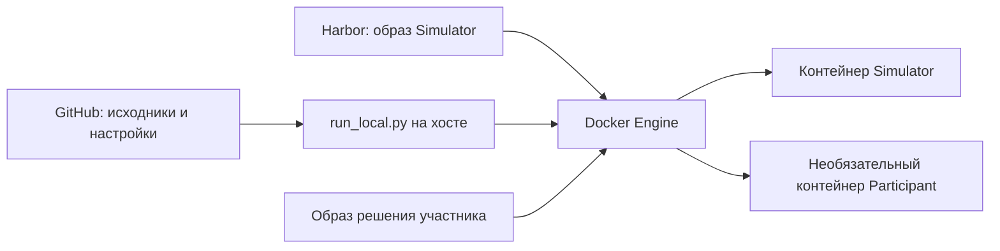

# Запуск публичного Simulator Unitree Go1

## 0. Подготовка окружения

### 0.1. Системные требования и первоначальная установка

Поддерживаемое окружение проекта: **Ubuntu 22.04, Linux amd64 (x86_64)**.
Нужны Docker Engine, Docker Compose plugin с поддержкой `!reset`, Git, Bash,
Python 3.10+, доступ пользователя к Docker daemon, HTTPS-доступ к GitHub,
Harbor `registry.cookcloud.ru` и репозиториям пакетов для установки инструментов.
ROS 2 Humble уже установлен внутри Docker-образа; устанавливать ROS 2 на хост
для стандартного запуска не требуется. NVIDIA GPU для headless не обязателен.
Подтверждённого минимального объёма RAM и свободного диска проект не задаёт;
предусмотрите место для Docker-образа и слоёв, при сборке — также для зависимостей
и build workspace. Проверить доступные ресурсы на хосте:

```bash
cat /etc/os-release
uname -m
dpkg --print-architecture
free -h
df -h . /var/lib
```

Ожидаются Ubuntu 22.04, `x86_64` и `amd64`. Далее — **первоначальная установка
на чистой Ubuntu 22.04**, команды выполняются на хосте.
Docker устанавливается из [официального apt-репозитория Docker](https://docs.docker.com/engine/install/ubuntu/).
На уже настроенной машине переходите к проверке версий; если установлены
конфликтующие пакеты Docker из Ubuntu, сначала выполните раздел удаления
конфликтующих пакетов в официальной процедуре.

```bash
sudo apt update
sudo apt install -y ca-certificates curl git bash python3
sudo install -m 0755 -d /etc/apt/keyrings
sudo curl -fsSL https://download.docker.com/linux/ubuntu/gpg -o /etc/apt/keyrings/docker.asc
sudo chmod a+r /etc/apt/keyrings/docker.asc
sudo tee /etc/apt/sources.list.d/docker.sources <<EOF_DOCKER
Types: deb
URIs: https://download.docker.com/linux/ubuntu
Suites: $(. /etc/os-release && echo "${UBUNTU_CODENAME:-$VERSION_CODENAME}")
Components: stable
Architectures: $(dpkg --print-architecture)
Signed-By: /etc/apt/keyrings/docker.asc
EOF_DOCKER
sudo apt update
sudo apt install -y docker-ce docker-ce-cli containerd.io docker-buildx-plugin docker-compose-plugin
sudo systemctl enable --now docker
```

Для работы launcher без `sudo` добавьте своего пользователя в группу Docker.
Эта группа даёт права уровня root, как указано в
[официальной инструкции после установки](https://docs.docker.com/engine/install/linux-postinstall/).

```bash
sudo groupadd -f docker
sudo usermod -aG docker "$USER"
```

Выйдите из пользовательского сеанса Ubuntu и войдите снова. Затем **на хосте**
проверьте инструменты и доступность daemon без `sudo`:

```bash
docker version
docker compose version
git --version
bash --version
python3 --version
docker info
docker run --rm hello-world
```

`docker version` должен показывать Client и Server, `docker info` — завершаться
успешно. `hello-world` скачивает небольшой проверочный образ из Docker Hub.
Если версии есть, но Server недоступен, проверьте `systemctl status docker`
и членство пользователя в группе через `id -nG`.

### 0.2. Получение проекта с GitHub

**Первое скачивание, хост:** из каталога, где хотите хранить проект:

```bash
git clone https://github.com/Urika000/go1-simulator-public.git
cd go1-simulator-public
```

GitHub предоставляет `run_local.py`, `participant_runtime.py`, Docker Compose,
конфигурации DDS, документацию, Dockerfile и исходники Simulator. Готовый
Docker-образ скачивается отдельно из Harbor.
Все дальнейшие команды проекта выполняются из корня клонированной копии.

**Обновление существующей копии, хост:** откройте терминал в её корне,
убедитесь через `git status`, что локальные изменения сохранены, затем:

```bash
git status
git pull --ff-only origin main
```

`git clone` нужен один раз; `git pull` обновляет уже существующую копию.
В пустом каталоге `git pull` не заменяет клонирование. При повторном запуске
повторять установку инструментов и клонирование не требуется.

### 0.3. Получение готового Docker-образа из Harbor

У каждого участника своя учётная запись Harbor, выданная организаторами.
**Хост:** команда `docker login` интерактивно запросит Username и Password
в терминале. Введите их там; пароль не помещайте в аргументы команд,
Git или конфигурационные файлы проекта.

```bash
docker login registry.cookcloud.ru
docker pull registry.cookcloud.ru/go1-hackathon-remote-stage/go1-sim:v1.0
export SIM_IMAGE=registry.cookcloud.ru/go1-hackathon-remote-stage/go1-sim:v1.0
docker image inspect "$SIM_IMAGE" --format '{{.Os}}/{{.Architecture}}'
docker image inspect "$SIM_IMAGE" --format '{{range .RepoDigests}}{{println .}}{{end}}'
```

Ожидается `linux/amd64` и RepoDigest
`registry.cookcloud.ru/go1-hackathon-remote-stage/go1-sim@sha256:c79ddbece6cc7d00f114a9a9a09be0bae061ebb35ca722bcbe51bf75fce1b2e3`.
Автоматическое сопоставление digest **на хосте**:

```bash
docker image inspect "$SIM_IMAGE" --format '{{range .RepoDigests}}{{println .}}{{end}}' | grep -Fx 'registry.cookcloud.ru/go1-hackathon-remote-stage/go1-sim@sha256:c79ddbece6cc7d00f114a9a9a09be0bae061ebb35ca722bcbe51bf75fce1b2e3'
```

Успех — напечатанная точная строка и код 0. Готовый образ можно использовать
сразу: `build_image.sh` и подготовка source-зависимостей не нужны.
При новом терминале повторно задайте `export SIM_IMAGE=...` из блока выше;
скачанный образ сохраняется в Docker. Для проверки обновления тега повторите pull
и проверку digest. Не используйте изменившийся digest как подтверждённый релиз.

### 0.4. Связь GitHub, Harbor и локального запуска

GitHub хранит исходники, настройки и скрипты запуска. Harbor хранит готовый
Docker-образ Simulator. `run_local.py` на хосте управляет контейнерами через
Docker: Simulator через Compose, необязательный Participant через Docker CLI.
Participant — отдельный образ, который участник создаёт самостоятельно.



### 0.5. Необязательная сборка из исходников

Только для разработчиков, изменяющих Simulator. Для обычного участия используйте
готовый образ. Подготовка зависимостей требует сети и доступа к Docker registry,
включая согласованную базу CookCloud. **Хост, корень проекта:**

```bash
docker login registry.cookcloud.ru
docker pull registry.cookcloud.ru/base_images/ros2-base-humble-amd64:v1.0.1
bash scripts/prepare-standalone-cache.sh
SIM_IMAGE=go1-sim:public BUILD_JOBS=1 bash build_image.sh
export SIM_IMAGE=go1-sim:public
```

Подробности кэша и закреплённых зависимостей — в разделе 2 и README.

### 0.6. Проверка готовности окружения

- GitHub-репозиторий клонирован, терминал открыт в его корне.
- Docker daemon доступен текущему пользователю.
- Docker Compose работает и понимает конфигурацию проекта.
- Авторизация в Harbor успешна.
- Simulator скачан, digest совпадает с опубликованным.
- Архитектура образа — `linux/amd64`.
- Справка launcher открывается.

**Хост, корень проекта:**

```bash
docker info > /dev/null
docker compose version
docker compose -f docker-compose.yml -f docker-compose.headless.yml config --quiet
docker image inspect "$SIM_IMAGE" --format '{{.Os}}/{{.Architecture}}'
python3 run_local.py --help
```

Теперь можно перейти к первому способу запуска в разделе 3.

## 1. Требования и подготовка окружения

Хост: Linux x86_64, Docker Engine, Docker Compose с поддержкой `!reset`,
Python 3.10+, Bash. Проверочная машина: Docker 29.9.3, Compose 5.7.0.
Docker daemon должен быть доступен текущему пользователю. ROS 2 Humble на хосте
не нужен: он установлен внутри Simulator. Все команды хоста ниже выполняются
из рабочего репозитория. Запускайте сценарии последовательно. Разные ROS domains не изолируют
Gazebo master при host network: параллельные Gazebo на одном хосте здесь
не предусмотрены.

**Хост:**

```bash
docker version
docker compose version
python3 --version
```

Headless работает без NVIDIA и `/dev/dri`; камеры Gazebo используют Xvfb и
программный OpenGL. Пять камер требуют заметных CPU/RAM; частота кадров по
времени симуляции не гарантирует такую же частоту по реальному времени.
GUI требует работающих X11, доступа контейнера к дисплею и `/dev/dri`.
GUI/GPU в проверках этой инструкции не испытывались.

## 2. Получение Docker-образа

### A. Готовый релиз Harbor — сборка исходников не нужна

**Хост:** авторизуйтесь интерактивно своей учётной записью. Не помещайте пароль
или токен в команды, Git и переписку.

```bash
docker login registry.cookcloud.ru
docker pull registry.cookcloud.ru/go1-hackathon-remote-stage/go1-sim:v1.0
docker image inspect registry.cookcloud.ru/go1-hackathon-remote-stage/go1-sim:v1.0 --format '{{json .RepoDigests}}'
export SIM_IMAGE=registry.cookcloud.ru/go1-hackathon-remote-stage/go1-sim:v1.0
```

Ожидаемый digest manifest:
`sha256:c79ddbece6cc7d00f114a9a9a09be0bae061ebb35ca722bcbe51bf75fce1b2e3`.
15.11.2026 реальный `docker pull` и `docker image inspect` подтвердили имя и digest.
Для закрепления ровно этого релиза можно вместо тега использовать:

```bash
export SIM_IMAGE=registry.cookcloud.ru/go1-hackathon-remote-stage/go1-sim@sha256:c79ddbece6cc7d00f114a9a9a09be0bae061ebb35ca722bcbe51bf75fce1b2e3
```

Launcher не скачивает образы автоматически: сначала выполните `docker pull`.
Если доступ запрещён, запросите у организаторов права и настройте `docker login`.

### B. Самостоятельная сборка

Это альтернативный путь. Используется согласованная CookCloud-база, без замены
публичным или экспериментальным образом. Подробности pins/cache:
[README](../README.md#подготовка-и-сборка).

**Хост:**

```bash
docker login registry.cookcloud.ru
docker pull registry.cookcloud.ru/base_images/ros2-base-humble-amd64:v1.0.1
bash scripts/prepare-standalone-cache.sh
SIM_IMAGE=go1-sim:public BUILD_JOBS=1 bash build_image.sh
export SIM_IMAGE=go1-sim:public
docker image inspect "$SIM_IMAGE" --format '{{.Os}}/{{.Architecture}} {{.Id}}'
```

Source-build подтверждён предыдущим [отчётом релиза](PUBLIC_RELEASE_VERIFICATION.md).
При подготовке этой инструкции пересборка и скачивание с пустым cache не проводились.
Далее выберите A или B и сохраните `SIM_IMAGE` в текущем терминале.

## 3. Быстрый запуск Simulator

**Хост:** один контейнер, без Participant, headless по умолчанию:

```bash
python3 run_local.py --task T2 --sim-only --sim-image "$SIM_IMAGE" --headless --logs
```

Launcher использует существующий Simulator Compose, выбирает свободный domain,
ждёт реальные `/clock` и `/lowstate` (MuJoCo) либо `/go1_ready=true` (Gazebo),
после чего пишет `Simulator started`. Остановка — Ctrl+C. Без управляющей
программы симуляция не выполняет решение задания; в T2/T3 нет команд приводам.

При `SIM_IMAGE`, экспортированном выше, достаточно:

```bash
python3 run_local.py --task T2 --sim-only
```

## 4. Запуск каждого задания T2–T5

Точные ручные команды в таблице предназначены для подготовленного shell из
раздела 5. `xvfb-run` — внешняя обёртка, а не аргумент ROS launch.

| Задание | Движок | Режим управления | Launch-команда внутри контейнера | Особенности |
|---|---|---|---|---|
| T2 | MuJoCo | Lowlevel, `/lowcmd` → `/lowstate` | `ros2 launch go1_simulation scenario.launch.py scenario:=lowlevel gui:=false` | Модель Go1 на полу; lockstep Gazebo неприменим |
| T3 | MuJoCo | Lowlevel, `/lowcmd` → `/lowstate` | `ros2 launch go1_simulation scenario.launch.py scenario:=lowlevel gui:=false` | Тот же сценарий Simulator; задача отличается аргументом Participant |
| T4 | Gazebo Classic | Highlevel, CHAMP, `/cmd_vel` | `xvfb-run -a ros2 launch go1_simulation scenario.launch.py scenario:=highlevel gui:=false cameras:=false lockstep:=true` | Мир `odom_validation`, передняя RGB-D включена по умолчанию |
| T5 | Gazebo Classic | Course, CHAMP, `/cmd_vel` | `xvfb-run -a ros2 launch go1_simulation scenario.launch.py scenario:=course width:=1.0 gui:=false cameras:=true lockstep:=true` | `course_w10`, проход 1 м, пять RGB-D |
| T5 | Gazebo Classic | Course, CHAMP, `/cmd_vel` | `xvfb-run -a ros2 launch go1_simulation scenario.launch.py scenario:=course width:=2.0 gui:=false cameras:=true lockstep:=true` | `course_w20`, проход 2 м, пять RGB-D |

`cameras` управляет четырьмя дополнительными камерами; `rgbd_camera` управляет
передней и по умолчанию включён для T4/T5. Пять префиксов: `/camera`,
`/camera_chin`, `/camera_left`, `/camera_right`, `/camera_rearDown`.
У каждой есть RGB, depth, camera_info и points. Course автоматически отправляет
`/goal_pose` после задержки и появления подписчика; Nav2 сам не запускается.

**Хост:** выполняйте одну выбранную команду, остановив предыдущую Ctrl+C:

```bash
python3 run_local.py --task T2 --sim-only --sim-image "$SIM_IMAGE" --headless --logs
python3 run_local.py --task T3 --sim-only --sim-image "$SIM_IMAGE" --headless --logs
python3 run_local.py --task T4 --sim-only --sim-image "$SIM_IMAGE" --headless --logs
python3 run_local.py --task T5 --sim-only --sim-image "$SIM_IMAGE" --course-width 1.0 --headless --logs
python3 run_local.py --task T5 --sim-only --sim-image "$SIM_IMAGE" --course-width 2.0 --headless --logs
```

LOCAL (оба режима Python launcher) включает lockstep для T4/T5, переднюю камеру
для T4 и все пять для T5. Прямой Compose без этих настроек имеет другие defaults:
lockstep выключен, `cameras:=auto` включает дополнительные камеры и в Highlevel.
Ручные команды выше явно воспроизводят LOCAL. Параметры физики не меняются.

## 5. Ручной запуск ROS 2 внутри контейнера

**Хост, терминал 1:** Compose `shell` запускает Bash через штатный entrypoint,
без автоматической симуляции. Замена entrypoint не нужна. `--rm` удалит контейнер
при выходе. Domain 151 здесь фиксирован: убедитесь, что другая симуляция его не использует.

```bash
SIM_IMAGE="$SIM_IMAGE" ROS_DOMAIN_ID=151 GO1_DDS_LOCAL=1 GO1_SIM_CYCLONEDDS_URI=file:///home/ros/ros2_custom_config_setup/cyclonedds_local.xml docker compose -f docker-compose.yml -f docker-compose.headless.yml run --rm --no-deps --pull never --name go1-manual shell
```

**Внутри контейнера:** workspace — `/home/ros/go1_ws`, пакет —
`go1_simulation`, общий launch-файл — `scenario.launch.py`.

```bash
source /opt/ros/humble/setup.bash
source /home/ros/go1_ws/install/setup.bash
source /etc/go1_sim_env.sh
cd /home/ros/go1_ws
ros2 pkg prefix go1_simulation
ros2 launch go1_simulation scenario.launch.py --show-args
```

Последний source дополняет ROS environment путями моделей и плагинов Gazebo,
отключает внешнюю базу моделей. Штатный entrypoint уже загружает этот файл;
повторный source безопасен. Одних двух ROS setup-файлов для полного окружения
Gazebo недостаточно. В shell headless X-сервер ещё не запущен, поэтому для
Gazebo ниже обязателен `xvfb-run -a`.

**Внутри контейнера:** выберите ровно одну команду:

```bash
# T2
ros2 launch go1_simulation scenario.launch.py scenario:=lowlevel gui:=false
# T3
ros2 launch go1_simulation scenario.launch.py scenario:=lowlevel gui:=false
# T4
xvfb-run -a ros2 launch go1_simulation scenario.launch.py scenario:=highlevel gui:=false cameras:=false lockstep:=true
# T5, 1 м
xvfb-run -a ros2 launch go1_simulation scenario.launch.py scenario:=course width:=1.0 gui:=false cameras:=true lockstep:=true
# T5, 2 м
xvfb-run -a ros2 launch go1_simulation scenario.launch.py scenario:=course width:=2.0 gui:=false cameras:=true lockstep:=true
```

Все launch-аргументы имеют defaults в исходниках; здесь явно заданы выбор
сценария и параметры, необходимые для соответствия LOCAL.
`lowlevel` включает `mujoco.launch.py` и `go1_mujoco.py`, модель
`/opt/mujoco_menagerie/unitree_go1`. Gazebo-ветка включает
`go1_simulation.launch.py`, `go1_config/bringup.launch.py` и `gazebo.launch.py`:
модель Go1, ros2_control, CHAMP, soft-start gate, lidar, RGB-D, контактные датчики
и source-built IMU plugin из образа. До `/go1_ready=true` действует soft-start.
Установка этих компонентов на хосте не нужна.

**Хост, терминал 2:** открыть дополнительный терминал того же контейнера:

```bash
docker exec -it go1-manual bash
```

Далее выполните диагностику из раздела 8 внутри контейнера. Для завершения
нажмите Ctrl+C в терминале с launch, затем `exit` во втором shell и `exit` в
первом. Контейнер удалится благодаря `--rm`. После прерванного launch Bash/Compose может
вернуть ненулевой код последней команды; проверяйте факт удаления контейнера.
В ручном smoke Gazebo при Ctrl+C выводил XIO/Boost mutex assertion; возврат
в shell и удаление контейнера подтверждены, чистое завершение gzserver не подтверждено.

## 6. Совместный запуск Simulator + Participant

Образ решения произвольный: исходный проект, Dockerfile примера и наследование
Simulator не требуются. Он должен быть `linux/amd64`, содержать исполняемый
`/entrypoint.sh`, принимать `ping` и поддерживаемые `T2/T3/T4/T5`. Задача работает
в foreground, обрабатывает SIGTERM и не поднимает собственный Simulator.
`ping` быстро завершается успешно; LOCAL launcher сам ping не вызывает.
Нужны ROS 2 Humble, используемые типы сообщений и CycloneDDS, с загрузкой
окружения внутри entrypoint. Полный контракт и типы: [README](../README.md#контракт-participant).

**Хост:** введите существующий тег своего собранного или опубликованного образа.
Это единственное значение, зависящее от решения участника; команды не требуют примера.

```bash
read -r -p 'Docker image вашего решения: ' PARTICIPANT_IMAGE
docker image inspect "$PARTICIPANT_IMAGE" --format '{{.Os}}/{{.Architecture}}'
```

Если образ ещё не загружен, предварительно выполните:

```bash
docker pull "$PARTICIPANT_IMAGE"
```

**Хост:** реальные параметры launcher, логи и отсутствие GUI:

```bash
python3 run_local.py --task T2 --sim-image "$SIM_IMAGE" --participant-image "$PARTICIPANT_IMAGE" --headless --logs
python3 run_local.py --task T3 --sim-image "$SIM_IMAGE" --participant-image "$PARTICIPANT_IMAGE" --headless --logs
python3 run_local.py --task T4 --sim-image "$SIM_IMAGE" --participant-image "$PARTICIPANT_IMAGE" --headless --logs
python3 run_local.py --task T5 --sim-image "$SIM_IMAGE" --participant-image "$PARTICIPANT_IMAGE" --course-width 1.0 --headless --logs
python3 run_local.py --task T5 --sim-image "$SIM_IMAGE" --participant-image "$PARTICIPANT_IMAGE" --course-width 2.0 --headless --logs
```

Simulator стартует через Compose, Participant — через `participant_runtime.py`
и Docker CLI. После готовности Simulator запускается Participant, выводится
`Pair started`. Оба используют host network, одинаковый domain и loopback DDS.
Launcher выбирает domain 100–229 и держит файловую блокировку; явный выбор:

```bash
python3 run_local.py --task T4 --sim-image "$SIM_IMAGE" --participant-image "$PARTICIPANT_IMAGE" --domain 151 --headless --logs
```

`--domain` передаётся обеим сторонам как `ROS_DOMAIN_ID`; значение переменной
хоста `ROS_DOMAIN_ID` launcher заменяет. Participant получает
`RMW_IMPLEMENTATION=rmw_cyclonedds_cpp`, `CYCLONEDDS_URI` как inline XML,
`ROS_LOCALHOST_ONLY=0`, `GO1_DDS_LOCAL=0`, `GUI=false`. Inline XML уже задаёт
loopback; не заменяйте его в entrypoint. Simulator получает тот же XML через
файл, `GO1_DDS_LOCAL=1`, и настройки из `/etc/go1_sim_env.sh`.
`ODOM_SOURCE` и `NAV_MODE`, если заданы на хосте, передаются Participant.
Для симуляционного времени используйте `/clock` и `use_sim_time`.
LOCAL не устанавливает Participant CPU/RAM/PIDs limits, пользователя и read-only
rootfs. Это среда локальной разработки с host network.

## 7. Все аргументы run_local.py

**Хост:**

```bash
python3 run_local.py --help
```

Defaults переменных окружения читаются при запуске процесса.

| Аргумент | Назначение | Default | Допустимые значения | Пример | Применимость |
|---|---|---|---|---|---|
| `-h`, `--help` | Справка и выход | — | флаг | `--help` | оба |
| `--task` | Задание | обязательный | T2, T3, T4, T5 | `--task T4` | оба |
| `--sim-only` | Только Simulator | false | флаг | `--sim-only` | один контейнер |
| `--sim-image` | Образ Simulator | `$SIM_IMAGE`, иначе `go1-sim:public` | локальный tag/digest linux/amd64 | `--sim-image "$SIM_IMAGE"` | оба |
| `--participant-image` | Образ решения | `$PARTICIPANT_IMAGE`, иначе `go1-participant:example` | локальный tag/digest linux/amd64 | `--participant-image "$PARTICIPANT_IMAGE"` | совместный; игнорируется в sim-only |
| `--headless` | Без GUI/устройств дисплея Simulator | headless уже default | флаг, несовместим с `--gui` | `--headless` | оба |
| `--gui` | GUI Simulator | false | флаг, несовместим с `--headless` | `--gui` | оба; X11/DRI |
| `--course-width` | Ширина Course, м | 1.0 | 1.0, 2.0 | `--course-width 2.0` | оба, влияет только на T5 |
| `--domain` | ROS domain | свободный 100–229 | целое 1–232 | `--domain 151` | оба |
| `--timeout` | Readiness, wall-секунды | 90 | положительное конечное число | `--timeout 180` | оба; не лимит длительности задачи |
| `--logs` | Следить за Docker logs | false | флаг | `--logs` | оба; только существующие контейнеры |
| `--gpus` | Docker GPU request Participant | нет | строка Docker, например all | `--gpus all` | совместный; игнорируется в sim-only |
| `--mount` | Явный bind mount Participant, повторяемый | пустой список | type=bind, src/source, dst/target/destination, опционально readonly | `--mount type=bind,src=/tmp,dst=/host-tmp,readonly` | совместный; игнорируется в sim-only |

Mount source должен существовать. `--gpus` требует настроенного Docker GPU
runtime и драйвера; он не включает GPU Simulator. `--gui` относится только к
Simulator. Отдельного флага lockstep у Python launcher нет.

## 8. Проверка ROS 2

Для launcher сначала возьмите имя из строки `Simulator=...` и откройте shell.
**Хост, новый терминал:**

```bash
read -r -p 'Имя из строки Simulator=: ' SIM_CONTAINER
docker exec -it "$SIM_CONTAINER" bash
```

Для ручного контейнера используйте `docker exec -it go1-manual bash`.
**Внутри контейнера:**

```bash
source /opt/ros/humble/setup.bash
source /home/ros/go1_ws/install/setup.bash
source /etc/go1_sim_env.sh
printenv ROS_DOMAIN_ID RMW_IMPLEMENTATION CYCLONEDDS_URI
ros2 node list --no-daemon
ros2 topic list --no-daemon
ros2 topic echo /clock --once --qos-reliability best_effort
```

T2/T3:

```bash
ros2 topic echo /lowstate --once --qos-reliability best_effort
```

T4/T5:

```bash
ros2 topic echo /go1_ready --once --qos-durability transient_local --qos-reliability reliable
ros2 topic echo /imu/data --once --qos-reliability best_effort
ros2 topic info /camera/image_raw --verbose
ros2 topic echo /camera/image_raw --once --field header --qos-reliability reliable
ros2 topic echo /camera/depth/image_raw --once --field header --qos-reliability reliable
pgrep -af gzserver
```

В командной строке реального gzserver ожидается `--lockstep`. Для T5 также:

```bash
ros2 topic echo /camera_chin/image_raw --once --field header --qos-reliability reliable
ros2 topic echo /camera_left/image_raw --once --field header --qos-reliability reliable
ros2 topic echo /camera_right/image_raw --once --field header --qos-reliability reliable
ros2 topic echo /camera_rearDown/image_raw --once --field header --qos-reliability reliable
```

Команды `echo --once` ждут сообщение; прервать ожидание можно Ctrl+C.
Большие RGB/depth кадры проверяйте с RELIABLE QoS. Наличие имени топика само
по себе не доказывает доставку данных.

## 9. Остановка контейнеров

Python launcher: Ctrl+C (exit 130), SIGTERM (143), SIGHUP (129).
Он останавливает и удаляет принадлежащие запуску контейнеры, завершает log
followers и освобождает domain lock. Неожиданное завершение контейнера даёт
ошибку и cleanup; в совместном режиме удаляются оба контейнера.
`--timeout` ограничивает только ожидание готовности.

Ручной запуск: Ctrl+C останавливает launch, затем `exit` закрывает shell.
Для аварийной остановки именованного ручного контейнера **на хосте**:

```bash
docker stop --time 5 go1-manual
docker ps -a --filter name=go1-manual
```

`--rm` удаляет остановленный ручной контейнер. SIGKILL самого launcher, сбой
хоста или Docker daemon не гарантируют cleanup. Проверяйте оставшиеся ресурсы:

```bash
docker ps -a --filter name=go1-local-
```

Для удаления конкретного оставшегося контейнера **на хосте**:

```bash
read -r -p 'Имя оставшегося контейнера этого запуска: ' STALE_CONTAINER
docker rm -f "$STALE_CONTAINER"
```

Не используйте глобальные prune/kill: они затронут другие работы.

## 10. Типичные ошибки и их устранение

| Симптом | Что проверить / исправить |
|---|---|
| Harbor unauthorized / denied | `docker login registry.cookcloud.ru`, права у организаторов; не заменять базу |
| No such image | Выполнить pull выбранного образа или source-build; проверить `--sim-image` |
| Compose unknown tag `!reset` | Обновить Docker Compose до версии с поддержкой `!reset` |
| Permission denied Docker socket | Настроить доступ текущего пользователя к Docker daemon |
| Readiness timeout | Посмотреть `--logs`; дождаться загрузки Gazebo, проверить CPU/RAM, при необходимости увеличить `--timeout` |
| Gazebo не открывает display из shell | Использовать приведённый `xvfb-run -a`; один `gui:=false` не создаёт X-сервер для камер |
| Модели/плагины не найдены | Подключить `/etc/go1_sim_env.sh`, использовать штатный образ и launch |
| Нет topics/payload | Проверить domain, DDS environment, source workspace, QoS; использовать новый shell/`--no-daemon` для discovery |
| Нет больших camera frames | RELIABLE reader; проверить нагрузку и UDP buffers; BEST_EFFORT может терять фрагменты |
| T4 показывает пять камер | При прямом launch явно задать `cameras:=false`; передняя остаётся включена |
| Participant быстро завершился | Проверить executable `/entrypoint.sh`, поддерживаемый аргумент задания, foreground и Docker logs |
| domain already reserved | Остановить другой launcher или выбрать другой `--domain`; не удалять блокировку работающего процесса |
| GPU request failed | Проверить NVIDIA/Docker runtime; для CPU запуска убрать `--gpus` |
| GUI не работает | Проверить X11/DRI и права дисплея; headless проверен отдельно |

### Границы практической проверки

Актуальные результаты smoke и точные команды проверки записаны в
[SIMULATOR_LAUNCH_VERIFICATION_RU.md](SIMULATOR_LAUNCH_VERIFICATION_RU.md).
Проверки короткие, подтверждают запуск/транспорт/остановку, а не качество
алгоритмов. Произвольный пользовательский образ требует собственной проверки
контракта; успешный тест интерфейсного образа не гарантирует работу любого image.
